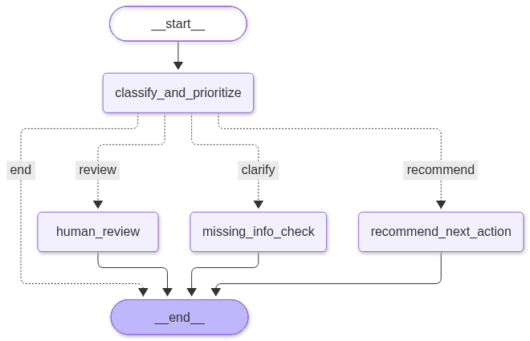

# Technical Document

## A. Problem Understanding

### Business Problem
Insurance support teams need to understand incoming requests and assign them with topic and urgency as well as decide how each ticket should be handled for downstream routing. Manual triage can lead to inconsistent priorities and incorrect routing, delaying responses and increasing the transfer cost among different departments/teams. I interpret this task as automating the initial triage process. The prototype acts as a decision-support agent: it classifies the main topic, assesses urgency, and recommends a next action, such as self-service guidance, claim handling, billing or technical support, or supervisor review. When missing information or unclear prevents a useful triage decision, a targeted clarification question should be proposed. The scope of this task covers the initial assessment and routing handling recommendation. However, the ticket resolving and processing follow-up replies are out of the task prototype.

### Assumptions

- The general IT/customer support tickets are treated as requests submitted to an **insurance** service support department. **The ticket original facts should be kept and never fake or create facts for various themes**. A primary topic will be identified from the content, and if no topic or urgency level can be determined, it will be marked as null.
- Using the dataset's original priorities and queues as references for the insurance triage decisions is an **evaluation assumption**.
- Urgency is scored by the ticket impact and time pressure: High for severe disruption, unresolved serious risks, or critical deadlines. Medium for other problems needing attention. Low is mostly for routine inquiries.
- Unclear or missing information triggers the clarification only when routing judgement is prevented, otherwise, a routing recommendation can be given.

## B. Data and Preprocessing
### Data Introduction
I use `aa_dataset-tickets-multi-lang-5-2-50-version.csv`: 28,587 records labeled English or German. All runs use the same 300 tickets in the same order, selected with shuffle seed 42 (181 English, 119 German, according to language mark, although some are wrongly marked in the original dataset). This exceeds the required 200 outputs while keeping local inference manageable. Both languages are retained without translation. The input text for triage agent includes `subject`and `body`. For RAG, other fields (language, queue, type, priority etc.) are as metadata and are as part of the input alongside retrieved text chunks. 

### Data Processing
1. The dataset is loaded using Python's `csv.DictReader`.
2. `subject` and `body` fields are chosen, Windows and older Mac line endings are converted to `\n`, Then the leading and trailing whitespaces are removed. This helps provide consistently formatted input.
3. `subject` and `body` after step 2 are combined using `Subject:` and `Body:`. This helps clarify the content summary and detail part. `text = ""` empty string when both fields are empty. This help avoid identifyting `Subject:` and `Body:` alone as content. Other fields keep original.

## C. Architecture and Tools

### Architecture
The agent uses a hybrid architecture that combines an LLM-based reasoning with a rule-based workflow control mechanism. The LLM makes decisions, while manual if-else deterministic rules select the workflow branch and validate the output labels and required fields. LangGraph orchestrates the overall workflow using nodes, edges, and conditional routing. Its main components are:
- **Ticket preparation:** preprocess the ticket and detects empty tickets.
- **Optional historical retrieval:** retrieves similar historical tickets and their metadata to provide classification prediction (first LLM use).
- **Classification and assessment:** a local LLM determines the topic, urgency, and whether to futher recommend an action, request clarification, or route directly human review.
- **Workflow routing:** conditional graph edges select the next step based on the assessment.
- **Action or clarification generation:** the second LLM call generates a handling recommendation or a clarification question for unclear or missing information. The human review branch in parallel records an escalation directly.
- **Validation and output:** validates required fields and allowed values. The workflow then assembles the structured result for JSON export. Runtime or output-validation errors produce an error result and can end the workflow. 

### Tools and Model Choice
#### Tools
**PyTorch:** provides local tensor computation and inference; **HuggingFace Transformers:** can load pretrained models and tokenizers and supports text generation; **LangGraph:** systematically orchestration agent workflow with node and conditional edges; **Sentence Transformers:** runs the local Qwen3 embedding models to encode historical text chunks and query tickets for semantic retrieval; **Chroma:** local vector storage and similarity search. Fits our data need: no need for a database server; **LangChain:** use for text splitting and integrates embedding generation with Chroma; **scikit-learn:** provides metrics calculation (accuracy, precision, recall, F1) for evaluating saved predictions; **pytest:** automate the scenario tests and workflow assertions.
#### Models
**Qwen3-1.7B:** a lightweight model that enables local inference with less weight memory than the tested 4B and 9B alternatives. Besides, its input and output max token limit can meed our ticket demands. Furthermore, it has the ability to process multilingual text, and it can cut huge running time, especially when thinking mode is on. For comparison, I also try larger models including **Qwen3.5-4B** and **Qwen3.5-9B** without thinking; **Qwen3-Embedding-0.6B / 4B:** provide embeddings for multilingual ticket retrieval. The 0.6B model is the lighter default. 4B was tested as a alternative with higher resource requirements.

## D. Agentic Workflow and Behavior
### Orchestration

  

Above graph shows the orchestration. Fixed line indicate normal directional connection while dash line indicates conditional edge. The first LLM inference produces topic, urgency, decision, and reason. Then, LangGraph routes the assessment to one of three branches based on the decision:

- **recommend:** for this decision, the workflow then executes a second LLM inference selects FAQ/self-service, claim handling, billing, technical support, or supervisor escalation.
- **clarify:** for this decision, the workflow then executes a second LLM inference generates a targeted question when missing information or unclear problem is assessed.
- **review:** for this decision, the workflow records supervisor escalation with the assessment reason, with no futher LLM call.

Each branch then reaches END. If a handled exception is encountered during the clarification or next-action routing recommendation, the workflow will record `status=“error”` (including error type and details) and then transition to the END state. If an unhandled exception is encountered, including cases where initial classification fails, the execution stops. Empty tickets receive a fixed clarification question without an LLM call and direct to END.

It is noted that the escalation to human supervisor/human review is available at two stages. Initial assessment can route requests directly to human review when the need is already clear, avoiding an unnecessary LLM call for next-action routing recommendation. During action recommendation, which is the second stage, escalation still remains available, and its intention is to differentitate the case that human handling is more appropriate comparing with the other actions.

LLM-based methods determine topic, urgency, and the workflow decision, then generate either a recommended action or a clarification question with the goal of obtaining unclear or missing information. If RAG is enabled, an embedding model represents ticket text for vector-similarity-based retrieval. This encoding process can belong to ML-method.

Deterministic rules handle empty tickets, validate required fields and allowed values (e.g. lower letter), and route further execution according to the LLM's decision. For the insurance business logic and criteria, they are written in prompts and can be interpreted by LLM instead of classical if-else rules.

## E. End-to-End Testing and Evaluation

### Tests and Metrics

I use Pytest as test framework to runs 5 [scenarios](tests/scenario_review_20_cases_Qwen3-1.7B_thinking.csv) through the triage agent workflow. Each scenario includes five cases, and the scenario includes normal requests, very short requests, long and complex problems, and scope boundaries. Additionally, an empty input is tested. Model, thinking, and RAG settings are configurable. The evaluation metrics include: 
- recorded errors counts and rates
- priority-urgency agreement accuracy, macro precesion/recall/F1, and High-priority recall. Missing or invalid urgency predictions count as incorrect.
- queue-action agreement measured by accuracy/macro precesion/recall/F1. Partial mappings are "queue_to_action": {
          "Billing and Payments": "Forward to billing team",
          "Technical Support": "Forward to technical support",
          "IT Support": "Forward to technical support"}.

### Experiment Results

Every run covers 300 tickets. Queue-action agreement covers 148 tickets. T/NT means thinking/non-thinking. Experiment results are documented in [the results summary](evaluation_results/result.md). Overall, 1.7B-thinking model with RAG shows a better performance, and larger embeddings show no consistent advantage. Additionally, clarifications fall from 33–35 in the 1.7B-thinking baselines to 6–7 with RAG, although this alone cannot fully indicate a better routing. 

It can be observed that the metric performance is relativ low than expected. Possible reason could be: 1. original urgency criteria may differ from the prompt; 2. the logic of general IT services and insurance fields are different, fixed mapping cannot establish full business correctness: in some cases, ground truth for IT servicve ticket is suitable but can be totally different when understanding in insurance concept. Although business boundaries, mappings, and concepts are described in prompts, LLM inference can not always provide ideal result as expected; 3. a stronger model could be much better under partial metrics, e.g. with 9b model, even without thinking and RAG support. 

## F. Limitations and Improvements
### Limitations
**Technical:** The current implementation processes is designed as one ticket at a time in sequence. It is due to the local machine hardware. Besides, the prototype does not execute actions or handle follow-up replies, which is consistent to the assignment scope. Future enhancements could incorporate tool calling to carry out  corresponding actions.

**Data and quality:** this limitation has already be mentioned in the last paragraph of [Experiment Results](#saved-experiment-results).

### Improvement with two more weeks:
The top priority is to improve agent performance based on current metrics. One approach is to swap in a more powerful model, though hardware limitations may make this difficult to validate. In addition, further testing and analysis will be conducted to identify the ticket type and language in which errors occur, and corresponding strategies will be added to the prompt or search constraints will be implemented.

The rest involves standardization tasks, integrating a UI, and completing a local deployment.

